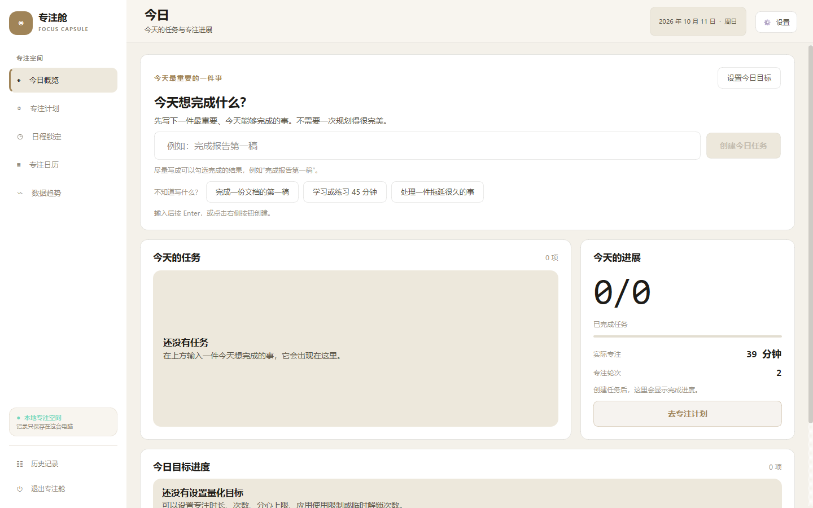
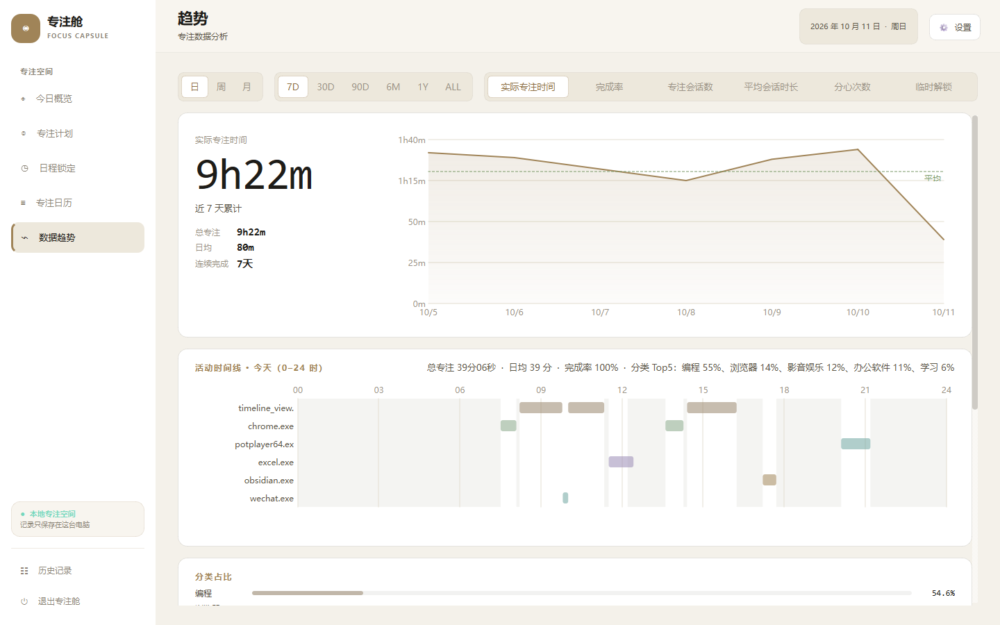
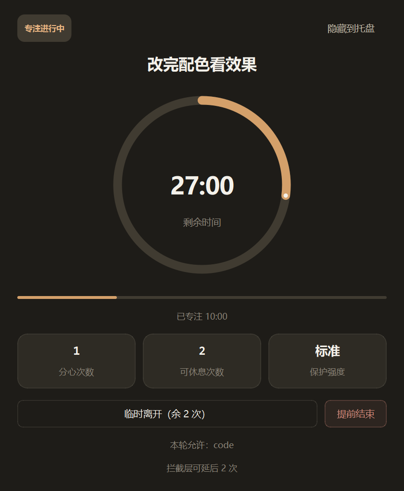
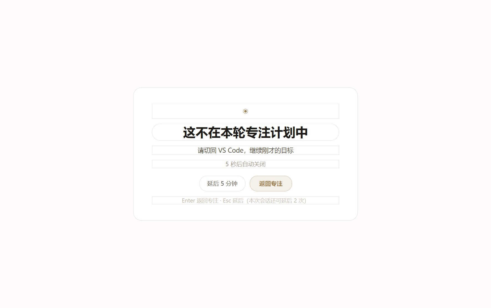
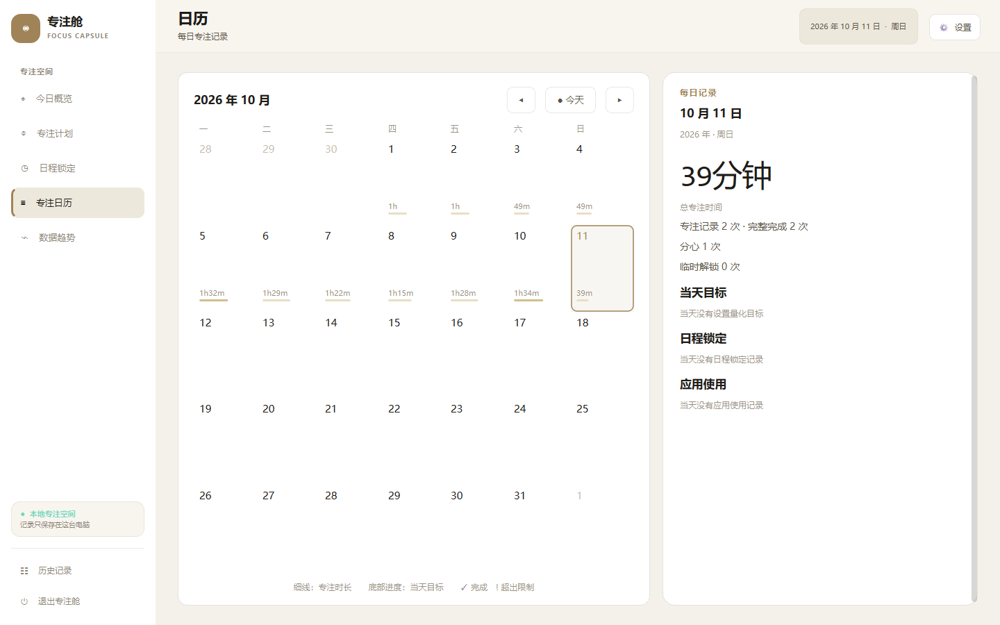

# 专注舱 Focus Capsule

**会看你正在用什么、并在你走神时温柔拦你一下的桌面专注工具。**

Windows / macOS / Android · 数据全在本地 · GPLv3

下载：[Windows 安装包](#下载) · [macOS](#下载) · [Android](#下载)

---

多数专注工具只做到两端的一端：**番茄钟**只管计时，不知道你这 25 分钟里到底在写代码还是在刷视频；**时间追踪器**知道你干了什么，但不会在你分心时拦你一下。专注舱做的是中间那件事——它知道你的前台应用，知道你这轮计划允许用哪些应用，走神时弹一层提醒，并把这些都记下来。

## 它怎么工作

**1. 前台感知，而不是拉黑清单。** 通过系统前台窗口（Windows 用 `win32gui`，macOS 用 `NSWorkspace`）识别你当前在哪个应用，白名单匹配精确到「进程名 + 可执行文件路径 + 进程血缘」，所以 `pythonw.exe` 启动的 IDE 不会被误判成脚本宿主。

**2. 柔性覆盖层，而不是硬锁屏。** 切到非白名单应用超过 1.2 秒，弹出一层提醒：Enter 立刻返回专注，Esc 延后 5 分钟（每个会话有延后额度，且只在弹层生命周期的前 30% 可用——借鉴 Stretchly 的延后策略，避免「随时可逃」）。深度模式下遮罩保持到你真的切回允许应用为止。

**3. 逃逸配额与破功记录。** 每次「临时离开」消耗一次配额并强制进入休息倒计时；配额用尽后仍要离开，本次专注记为**破功**，在日历上以枯枝形态永久保留（Forest 的做法：惩罚是留痕，不是弹窗）。提前结束同样记为破功。

**4. 严格模式：把「一时手痒」和「真的想结束」分开。** 三档纯逻辑锁——冷静期倒计时（1–240 分钟，期间专注照常计时，随时可放弃退出且不留记录）、输入随机字符、输入口令（只存 PBKDF2 加盐哈希）。同时用单调钟检测系统时间回拨：改表不能提前结束锁定，只会立刻终止并记为破功。

**5. 作息排程自动起停。** 按时间段自动开始/结束锁定，每条规则有独立的强度（轻柔 / 标准 / 深度）、独立白名单、独立逃逸配额与严格模式档位——早自习和下午写代码可以是两套完全不同的规则。

**6. 数据侧：时间线 + 分类 + 连续记录。** 按小时的应用使用时间线（每应用一行色条，AFK 区间灰色标出）、分类占比、日/周/月聚合、连续达标天数、日历热力图。可选的 AI 日报默认关闭，需要你自己填 API Key。

## 截图

| 今日概览 | 活动时间线与分类占比 |
| --- | --- |
|  |  |
| **专注进行中（深色模式）** | **走神时的接管弹层** |
|  |  |
| **专注日历** | |
|  | |

## 下载

| 平台 | 产物 | 状态 |
| --- | --- | --- |
| Windows 10/11 x64 | `Focus-Capsule-4.0.0-Windows-x64-Setup.exe` | ✅ CI 每次打 tag 自动构建 |
| macOS (Apple Silicon) | `Focus-Capsule-4.0.0-macOS-arm64.dmg` | ✅ CI 构建，未做签名公证 |
| Android 8.0+ (arm64) | `Focus-Capsule-4.0.0-Android-arm64-v8a.apk` | ✅ CI 构建，未签名 |

去 [Releases](../../releases) 页面下载，每个产物旁边有 `SHA256SUMS.txt`。

macOS 首次打开会被 Gatekeeper 拦下（未做 notarize）：右键 → 打开，或 `xattr -dr com.apple.quarantine /Applications/"Focus Capsule".app`。

## 平台差异（说实话部分）

- **覆盖层不是驱动级封锁。** 它提高分心的成本，但结束进程、进安全模式、换账号登录仍然绕得过去——那是 Cold Turkey 用内核级手段解决的问题，不在一个开源项目的射程内。想要「不可破」的锁，请用商业产品。
- **Android 端只能提醒，不能拦截。** 受系统限制，App 只能读 Usage Access 前台记录并弹悬浮窗，无法禁止别的 App 打开。桌面端是主力，移动端更像打卡与陪跑。
- **macOS 需要辅助功能权限**才能稳定拿到前台应用名；未授权时降级为「只计时不拦截」。
- **AI 日报默认关闭**，开启后仅把你本机的使用统计发给你自己配置的 API 端点。

## 隐私

所有记录写在本机用户目录的 JSON 文件里，没有账号、没有服务器、没有遥测。卸载即清空。

- Windows：`%APPDATA%\FocusCapsule\Focus Capsule\`（会话历史、每日目标、活动统计、事件区间）；另有 `%LOCALAPPDATA%\FocusCapsule\clock_guard.json` 用于改时间检测
- macOS / Linux：`~/Library/Application Support/FocusCapsule/Focus Capsule/` 与 `~/.local/share/FocusCapsule/Focus Capsule/`

## 从源码运行

```bash
python -m venv .venv
.venv/Scripts/pip install -r requirements.txt   # Windows
.venv/Scripts/python -m focus_capsule            # 启动

.venv/Scripts/python -m pytest tests -q          # 跑测试
```

构建安装包：`packaging/build_windows.ps1`（需要 Inno Setup）、`packaging/build_macos.sh`（需要 macOS）。Android 端在 `focus_capsule_flutter/`，`flutter build apk --release`。

CI 由 `.github/workflows/release.yml` 在打 `v*` tag 时构建三端并发布 Release。

## 许可

GPLv3。欢迎商用与二次分发，但修改后的源码需同样开源。

---

## English

Focus Capsule is a desktop focus tool that sits between a pomodoro timer and a website blocker. It watches the foreground application, knows which apps your current session allows, and intervenes with a soft overlay when you drift — rather than hard-blocking your machine.

Key mechanics: foreground-aware overlay with keyboard-reachable exits and a limited, time-boxed snooze; an escape budget that records a broken session permanently on the calendar; three strict-mode locks (cooldown, random phrase, passcode) plus monotonic-clock detection of system-time rollback; per-time-window schedule rules each with their own intensity, whitelist and strictness; and an ActivityWatch-style hourly timeline with category breakdown.

Data stays local as JSON. GPLv3. Windows and macOS are the primary targets; the Android build records and reminds but cannot block other apps under system restrictions.
